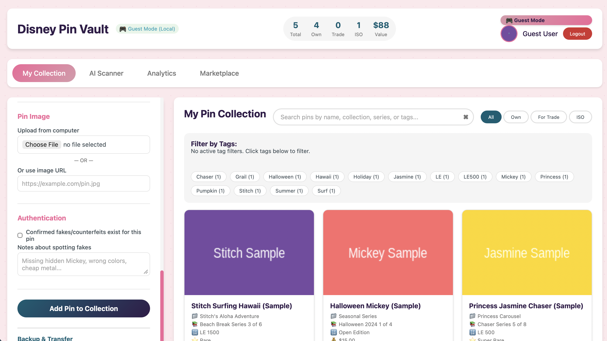
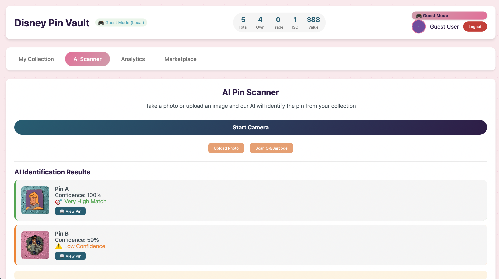
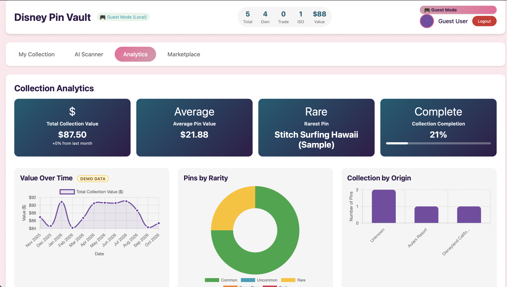

# 🏰 Disney Pin Vault

[](https://github.com/mehersalim/Disney-Pin-Vault/actions/workflows/ci.yml)
[](LICENSE)
[](https://firebase.google.com)
[](https://www.tensorflow.org/js)

A web app for Disney pin collectors to track, trade, and treasure their collections. Built with vanilla JavaScript, Firebase, and TensorFlow.js.

> **Unofficial fan project.** Disney Pin Vault is not affiliated with, endorsed by, or sponsored by The Walt Disney Company. Disney and related names and marks are trademarks of their respective owners.

**[▶ Try the live demo](https://mehersalim.github.io/Disney-Pin-Vault/)** (no signup needed: choose **Continue as Guest**)

## Screenshots

| Collection | AI Scanner | Analytics |
|:---:|:---:|:---:|
|  |  |  |

## Features

> **Status:** Collection management, search, and guest mode are working features. Cloud sync and trading are built against Firebase but have not been tested end-to-end yet. The Marketplace panel and the "Value Over Time" chart run on **simulated demo data** (labeled in the app). See [Known limitations](#known-limitations).

### Collection Management
- Add, edit, and delete pins with detailed information
- Track pins by status: Own, For Trade, or ISO (In Search Of)
- Upload photos (local files) or use image URLs
- Tag system with auto-suggestions
- Guest mode: use the app instantly with no account; data stays in your browser

### Search & Filter
- Search by name, collection, series, or tags
- Filter by status (Own / Trade / ISO) and by custom tags
- Sort and organize your collection

### AI Pin Scanner
- Take a photo or upload an image to find the closest match **in your own collection**
- Uses TensorFlow.js MobileNet embeddings with cosine similarity
- Ranked results with similarity scores

### Analytics Dashboard
- Total collection value (from the values you enter)
- Rarity distribution and origin breakdown charts
- Most valuable pins ranking and series completion tracking
- Collection insights generated from your data
- *Demo data:* the "Value Over Time" chart uses simulated history

### Marketplace Preview (Demo mode: simulated data)
- Simulated eBay and Mercari listings, sold comps, and price history to demonstrate the UI
- Trend analysis and a simple linear-regression projection, run on the simulated data (not financial advice)
- Controlled by `USE_MOCK_DATA` in `price-api.js`; live integration is planned and needs a server-side API key

### Trading System
- Find collectors with your ISO pins
- Propose and respond to trade offers
- Offer management dashboard

### Cloud Sync
- Firebase authentication (Email / Google)
- Cross-device synchronization and offline support
- Backup and restore (JSON import/export)

## Technologies Used

| Technology | Purpose |
|------------|---------|
| HTML5 / CSS3 | Structure and styling |
| JavaScript (ES6+) | Application logic |
| Firebase | Auth, Firestore database, Storage |
| TensorFlow.js + MobileNet | Image embeddings for the scanner |
| Chart.js | Data visualization |
| day.js | Date handling |
| html5-qrcode | QR/barcode scanning |

## Getting Started

### Prerequisites
- A modern browser (Chrome, Firefox, Safari)
- Git
- Node.js 22 or newer, to run the tests and linter (`npm install`, then `npm test` and `npm run lint`)
- Python 3 or Node.js, only to run a local server (optional)
- A free Firebase account, only if you want accounts, cloud sync, and trading (optional)

### Run it locally

```bash
git clone https://github.com/mehersalim/Disney-Pin-Vault.git
cd Disney-Pin-Vault
python3 -m http.server 8000
```

Then open <http://localhost:8000> and choose **Continue as Guest**. Guest mode needs no Firebase setup. The AI model loads from a CDN, so you need an internet connection. Use `localhost` (not a plain file) if you want to try the camera.

### Connect your own Firebase project (optional)
1. Create a project in the [Firebase console](https://console.firebase.google.com/) and add a web app.
2. Enable **Authentication** (Email/Password and Google), **Firestore**, and **Storage**.
3. Replace the placeholder values in `firebase-config.js` with your project's config.
4. Publish the security rules: copy `firestore.rules` into Firestore → Rules, and `storage.rules` into Storage → Rules.

Firebase web config values are not secrets, but your security rules are what protect your data, so publish them before inviting anyone to use your project.

## Project Structure

```
├── index.html          # App layout and pages
├── style.css           # Styling
├── script.js           # App logic (auth, pins, trades, analytics UI)
├── ml-model.js         # TensorFlow.js pin scanner
├── price-api.js        # Marketplace price module (demo/simulated data)
├── validate-import.js  # Checks and cleans backup files before import
├── chart-config.js     # Chart.js chart builders
├── firebase-config.js  # Firebase setup (placeholder values)
├── firestore.rules     # Database security rules
├── storage.rules       # Photo storage security rules
├── sample-pins.json    # Sample data for testing import
├── tests/              # Automated tests (Vitest)
├── eslint.config.mjs   # Lint rules (ESLint)
├── .github/workflows/  # CI: runs lint and tests on every push
├── docs/               # README screenshots
└── LICENSE
```

## Known limitations

This is a learning project, and I'd rather list what doesn't work yet than overclaim.

- **Marketplace data is simulated.** Listings, sold comps, price history, and the "Value Over Time" chart are generated, not pulled from eBay or Mercari. Don't use them to price real pins.
- **The scanner is a prototype.** It uses a general-purpose image model that wasn't trained on pins, and it only matches against pins already in your collection. In informal testing with three photos, the exact same photo scored 100%, but a new photo of the same pin scored about the same as different pins, likely because textured backgrounds dominate the score. A proper accuracy evaluation is planned.
- **Trading hasn't been tested end-to-end.** Collector discovery in particular needs user profile records the app doesn't create yet.
- **Guest-mode storage is small.** Guest data lives in browser storage (about 5 MB), and photos are saved at full size, so a handful of large photos can fill it. Resizing on upload is planned.
- **Test coverage is still small** (scanner math, price trends, import checking), and `script.js` is one large file.

## Roadmap

- [x] Automated tests and CI (more coverage planned)
- [ ] Split `script.js` into modules
- [ ] Measure scanner accuracy and improve photo matching
- [ ] Save real collection-value snapshots over time
- [ ] Live marketplace data through a server-side function
- [ ] Resize photos on upload; create user profiles for trading

## Author

Built by **Meher Salim** ([@mehersalim](https://github.com/mehersalim)).

## License

Released under the [MIT License](LICENSE).
